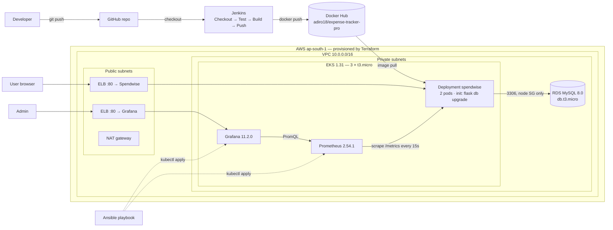

# Spendwise — Cloud-Based Expense Tracker with DevOps Automation

Course project for **21CSE333P – Essentials in Cloud and DevOps (SRM IST)**.

Spendwise is a multi-user expense & budget tracker (Flask + MySQL) delivered through a complete
DevOps chain: **Git/GitHub → pytest → Docker → Jenkins → Docker Hub → Terraform (AWS VPC + EKS + RDS)
→ Kubernetes → Ansible → Prometheus + Grafana**.

## Features

* Register / login (rate-limited: 5 POSTs per minute), logout, CSRF protection on every form
* Accounts: bank, cash, credit card, debit card, UPI — with live balances
* Transactions: income / expense, filter by month, category, account; edit / delete; pagination
* Budgets per category per month with progress bars (green < 75 % < amber < 100 % < red)
* Dashboard: income, expense, net, savings rate %, total balance, **month-end spending forecast**
  (spend so far ÷ days elapsed × days in month), category doughnut chart, daily and 6-month trend charts,
  recent transactions, CSV export
* Strict per-user data isolation (another user's record → 404)
* `/health/live`, `/health/ready` (runs `SELECT 1`, 503 when the DB is down) and `/metrics` (Prometheus)

## Architecture



## Tech stack

| Layer | Technology |
|---|---|
| Language / framework | Python 3.11, Flask 3.0 (application factory + 6 blueprints) |
| Data | SQLAlchemy 2.0, Flask-Migrate (Alembic), MySQL 8.0 via PyMySQL (SQLite fallback locally) |
| Security | Flask-Login, Flask-WTF / WTForms (CSRF + validation), Flask-Limiter, Werkzeug password hashing |
| UI | Jinja2 templates, plain responsive CSS, Chart.js 4 (CDN) |
| Telemetry | prometheus-client: `http_requests_total`, `http_request_duration_seconds` |
| App server | Gunicorn (2 workers) |
| Tests | pytest + pytest-cov (55 tests, coverage gate 85 %) |
| Container | Multi-stage Dockerfile, `python:3.11-slim`, non-root user, ~67 MB compressed |
| CI | Jenkins (Docker), 5-stage declarative pipeline, Docker Hub |
| IaC | Terraform ≥ 1.5, AWS provider ~> 5.0, `terraform-aws-modules/vpc` ~> 5.0, `eks` ~> 20.0 |
| Orchestration | Amazon EKS 1.31, Deployment + LoadBalancer Service |
| Config management | Ansible (kubectl-driven, idempotent) |
| Monitoring | Prometheus 2.54.1, Grafana 11.2.0 ("Spendwise Operations" dashboard) |

## Project layout

```
app/            Flask app: __init__.py (create_app), config, extensions, models, forms,
                metrics, seed, utils, blueprints (auth, accounts, transactions, budgets,
                dashboard, health), templates/, static/
migrations/     Alembic migrations (flask db ...)
tests/          pytest suite
wsgi.py         app = create_app()  (gunicorn wsgi:app)
gunicorn.conf.py  merges Prometheus metrics across gunicorn workers
Dockerfile, .dockerignore, docker-compose.yml
Jenkinsfile, jenkins/        CI pipeline + Jenkins image
terraform/      versions, provider, variables, vpc, eks, rds, outputs
k8s/            configmap, deployment, service, secrets.example.md
ansible/        inventory, playbook, manifests/ (Prometheus + Grafana)
monitoring/     Prometheus/Grafana config for docker compose (same dashboard JSON)
scripts/        deploy / teardown / smoke_test (.sh + .ps1)
```

## Configuration (environment variables)

| Variable | Default | Notes |
|---|---|---|
| `APP_ENV` | `development` | `development` \| `testing` \| `production` |
| `SECRET_KEY` | dev fallback | **required** when `APP_ENV=production` |
| `DB_HOST` | *(empty)* | empty → SQLite `instance/spendwise.db` |
| `DB_PORT` | `3306` | |
| `DB_NAME` | `spendwise` | |
| `DB_USER` / `DB_PASSWORD` | | from a Kubernetes Secret in production |
| `DEFAULT_CURRENCY` | `INR` | shown as ₹ with Indian digit grouping |
| `RATELIMIT_STORAGE_URI` | `memory://` | set to `redis://…` to share limits across workers/pods |

Copy `.env.example` to `.env` for local development (`.env` is gitignored).

---

## 1. Run locally (virtualenv + SQLite)

```bash
python3.11 -m venv venv
source venv/bin/activate          # Windows: venv\Scripts\activate
pip install -r requirements.txt
export FLASK_APP=wsgi.py          # PowerShell: $env:FLASK_APP="wsgi.py"
flask db upgrade
flask seed                        # demo / Demo@1234, 212 transactions
flask run --port 8000             # or: gunicorn --bind 127.0.0.1:8000 --workers 2 wsgi:app
```

Open http://localhost:8000 and log in as **demo / Demo@1234**.

## 2. Run locally with Docker Compose (MySQL 8.0 + optional monitoring)

```bash
docker compose up -d --build                      # app + mysql
docker compose exec app flask seed
./scripts/smoke_test.sh http://localhost:8000     # PowerShell: .\scripts\smoke_test.ps1

# with Prometheus (http://localhost:9090) and Grafana (http://localhost:3000, admin/admin)
docker compose --profile monitoring up -d --build

docker compose --profile monitoring down -v       # stop and delete data
```

## 3. Tests

```bash
pytest                                            # options come from pytest.ini
pytest --cov=app --cov-report=term-missing --cov-report=xml
```

Covers auth (incl. wrong password and the rate limit), user isolation, validation (negative amount,
future date, foreign category/account), CRUD for accounts/transactions/budgets, budget progress,
dashboard aggregates and forecast, CSV export, health probes (503 with a mocked DB failure) and `/metrics`.

## 4. Docker image

```bash
docker build -t adiro18/expense-tracker-pro:latest .
docker images adiro18/expense-tracker-pro          # CONTENT SIZE ≈ 67 MB
# For EKS (x86_64 nodes) from an Apple Silicon Mac:
docker build --platform linux/amd64 -t adiro18/expense-tracker-pro:latest .
docker login && docker push adiro18/expense-tracker-pro:latest
```

## 5. Jenkins CI

See [jenkins/README.md](jenkins/README.md). Short version:

```bash
docker build -t spendwise-jenkins ./jenkins
docker run -d --name jenkins -p 8080:8080 -v jenkins_home:/var/jenkins_home \
  -v /var/run/docker.sock:/var/run/docker.sock --group-add 0 spendwise-jenkins
docker exec jenkins cat /var/jenkins_home/secrets/initialAdminPassword
```

Then add the Docker Hub credential **`dockerhub-creds`** and a *Pipeline from SCM* job pointing at
`https://github.com/adiro18/expense-tracker-pro.git`.
Pipeline: **Checkout SCM → Test → Build image → Push image → Post actions**.

## 6. Deploy to AWS (⚠️ costs money)

Prerequisites: `aws configure` with an IAM identity allowed to manage EC2/VPC, EKS, IAM roles, RDS,
KMS and CloudWatch Logs (e.g. `AdministratorAccess` on a personal account), plus `kubectl`, `terraform`, `ansible`.

Approximate cost while running (ap-south-1):

| Item | ≈ $/hour |
|---|---|
| EKS control plane (standard support) | 0.10 |
| NAT gateway (+ data) | 0.056 |
| 3 × t3.micro nodes | 0.034 |
| RDS db.t3.micro MySQL + 20 GB gp3 | 0.03 |
| 2 × Classic ELB + public IPv4 | 0.08 |
| **Total** | **≈ 0.30 / hour (≈ $7 / day)** |

> If the EKS version or MySQL major version is in AWS **extended support**, extra charges apply
> (EKS: $0.60/h instead of $0.10/h; RDS: per-vCPU-hour surcharge). Check the AWS console before applying
> and override `cluster_version` / `mysql_version` in `terraform.tfvars` if needed.

### One command

```bash
export TF_VAR_db_password='choose-a-strong-password'
./scripts/deploy.sh          # PowerShell: .\scripts\deploy.ps1
```

### Step by step

```bash
cd terraform
export TF_VAR_db_password='choose-a-strong-password'
terraform init
terraform plan               # ≈ 57 resources
terraform apply              # ~15-20 min (EKS + RDS)
aws eks update-kubeconfig --region ap-south-1 --name spendwise-eks
terraform output rds_endpoint
cd ..

# secrets (see k8s/secrets.example.md)
kubectl create secret generic spendwise-secrets \
  --from-literal=SECRET_KEY="$(openssl rand -hex 32)" \
  --from-literal=DB_USER=spendwise_admin \
  --from-literal=DB_PASSWORD="$TF_VAR_db_password"

# put the RDS endpoint into the ConfigMap and deploy
sed "s|REPLACE_WITH_RDS_ENDPOINT|$(terraform -chdir=terraform output -raw rds_endpoint)|" k8s/configmap.yaml | kubectl apply -f -
kubectl apply -f k8s/deployment.yaml -f k8s/service.yaml
kubectl rollout status deployment/spendwise
kubectl exec deploy/spendwise -c spendwise -- flask seed
kubectl get svc spendwise    # EXTERNAL-IP = ELB hostname → http://<hostname>
```

## 7. Monitoring (Ansible → Prometheus + Grafana)

```bash
kubectl create namespace monitoring
kubectl -n monitoring create secret generic grafana-admin --from-literal=password="$(openssl rand -base64 18)"
ansible-playbook -i ansible/inventory.ini ansible/playbook.yml --syntax-check
ansible-playbook -i ansible/inventory.ini ansible/playbook.yml

kubectl -n monitoring get svc grafana          # http://<hostname>  (admin / the secret above)
# or without an ELB:  kubectl -n monitoring port-forward svc/grafana 3000:80

./scripts/smoke_test.sh http://<spendwise-elb-hostname> 200   # generates traffic for the dashboard
```

WSL Ansible + Windows `kubectl.exe`:

```bash
ansible-playbook -i ansible/inventory.ini ansible/playbook.yml \
  -e kubectl=kubectl.exe -e manifests_dir=E:/Projects/expense-tracker-pro/ansible/manifests
```

Dashboard **Spendwise Operations** panels:

| Panel | PromQL |
|---|---|
| App Request Rate | `rate(http_requests_total[5m])` |
| Average Response Time | `rate(http_request_duration_seconds_sum[5m]) / rate(http_request_duration_seconds_count[5m])` |
| Success Rate (%) | `sum(rate(http_requests_total{status=~"2.."}[5m])) / sum(rate(http_requests_total[5m])) * 100` |
| Total Requests Served | `sum(http_requests_total)` |

## 8. Demo commands

```bash
kubectl get nodes -o wide
kubectl get pods -A
kubectl get svc spendwise
kubectl -n monitoring get pods,svc

# Self-healing: delete a pod and watch the Deployment replace it
kubectl get pods -l app=spendwise
kubectl delete pod <pod-name>
kubectl get pods -l app=spendwise -w

# Scale pods / nodes
kubectl scale deployment spendwise --replicas=3
aws eks list-nodegroups --cluster-name spendwise-eks --region ap-south-1
aws eks update-nodegroup-config --cluster-name spendwise-eks --region ap-south-1 \
  --nodegroup-name <nodegroup-name> --scaling-config minSize=1,maxSize=4,desiredSize=4

# Seed demo data, look at logs and probes
kubectl exec deploy/spendwise -c spendwise -- flask seed
kubectl logs deploy/spendwise -c migrate
kubectl logs -l app=spendwise --tail=20
kubectl describe pod -l app=spendwise | grep -A3 -E "Liveness|Readiness"

# Talk to RDS with a throwaway MySQL client pod
kubectl run mysql-client --rm -it --image=mysql:8.0 -- \
  mysql -h <rds-endpoint> -u spendwise_admin -p spendwise
```

## 9. Teardown (do this right after the demo!)

```bash
./scripts/teardown.sh        # PowerShell: .\scripts\teardown.ps1
```

It deletes the LoadBalancer Services first (their ELBs are created by Kubernetes, not Terraform, and
would block VPC deletion), waits for AWS to release them, then runs `terraform destroy`.
Afterwards check EC2 → Load Balancers, VPC → NAT gateways and RDS in **ap-south-1** are empty.

---

## Known issues & fixes

| Problem | Cause | Fix |
|---|---|---|
| Jenkins: `WorkflowScript: 1: unexpected char: '\uFEFF'` | Jenkinsfile saved as UTF-8 **with BOM** (e.g. PowerShell `>` redirection) | Save as UTF-8 without BOM; check with `head -c 3 Jenkinsfile \| xxd` (must start `7069 70`) |
| `pip install` timeouts in Jenkins / Docker | Slow network to PyPI | `--timeout=180 --retries=10` on every `pip install` |
| Push fails with explicit `https://registry.hub.docker.com` | Local Docker Hub mirror/proxy rejected the explicit host | `docker.withRegistry('', 'dockerhub-creds')` – empty string = default registry |
| Node group creation fails with `t3.medium` | Account limited to free-tier eligible instance types | `node_instance_type = "t3.micro"` |
| Pods stuck `Pending` (`Too many pods`) | t3.micro ENI limit → **max 4 pods per node** (incl. aws-node, kube-proxy, CoreDNS) | 3 nodes (`node_desired_size = 3`), small resource requests for Prometheus/Grafana |
| Changing `node_desired_size` does nothing | EKS module ignores `desired_size` after creation | `aws eks update-nodegroup-config --scaling-config …desiredSize=N` |
| WSL Ansible can't find manifests when using `kubectl.exe` | Windows binary doesn't understand `/mnt/e/...` paths | `-e kubectl=kubectl.exe -e manifests_dir=E:/Projects/expense-tracker-pro/ansible/manifests` |
| App pods `OOMKilled` | 256Mi limit too small for 2 gunicorn workers + SQLAlchemy | Memory limit **512Mi** (request 192Mi) |
| `exec format error` on EKS | Image built on Apple Silicon (arm64), nodes are x86_64 | Jenkinsfile builds with `--platform linux/amd64` |
| Login rate limit allows more than 5/min | `memory://` limiter storage is per gunicorn worker/pod | Fine for a demo; set `RATELIMIT_STORAGE_URI=redis://…` to share |
| Grafana totals jump between values | Prometheus scrapes the Service, which picks one of the 2 pods per scrape (no service discovery – deliberate) | Use `kubernetes_sd_configs` + RBAC to scrape each pod |
| Image was > 100 MB | `default-mysql-client` added ~140 MB and the app doesn't use it | Removed; use `kubectl run mysql-client --image=mysql:8.0` for debugging |
| Ansible `Unexpected args` | Paths with spaces split by `command:` string form | Tasks use `argv:` lists |
